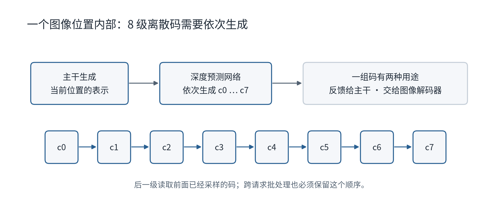

# LongCat-Next：模型相同，推理框架为什么仍会不同

这份材料解释 LongCat-Next 从官方推理实现接入 vLLM-Omni 时，需要保持哪些计算规则、处理哪些运行时差异。它依据固定版本源码和已有局部验证，不包含新的框架性能对比。

## 先理解模型在生成什么

LongCat-Next 可以处理文字、图片和声音。它把图片、声音转换为离散编号，再由共享主干处理这些编号。可以把主干理解成负责上下文推理的主体网络，把媒体解码器理解成将编号还原成图片或声音的模块。

生成图片或声音时，一个位置需要一组编号，而不是一个普通文本 token。RVQ，即残差向量量化，用多个码逐级补充表示；这里每个位置生成 8 级码。负责这项工作的网络叫 depth head，本文称“深度预测网络”。

图中的箭头表示计算依赖，不表示实测耗时。主干沿空间或时间位置前进；深度网络在每个位置内部依次预测 `c0 → c1 → … → c7`，后一级依赖前面已采样的码。

有三个容易混淆的数字：checkpoint 有 14 个复合 block，每个包含两个 attention 模块，合计 28 个；视觉和音频深度网络各有 4 层；每个位置生成 8 级码。这三个数字分别描述主干结构、深度网络结构和输出表示，不能互换。

主干采用 MLA、Shortcut MoE 和 N-gram embedding。对这份比较，最重要的是 N-gram 查表还需要保存每个请求的短历史，而标称激活参数量不能直接代表完整权重的显存需求。结构细节见[技术原稿](analysis.md)。

## 相同模型为什么不自动意味着相同结果

两套实现必须保持相同的逐级码依赖、合法编号范围和反馈规则。生成的码除了用于最终解码，还会被转换为向量，反馈给主干的下一步；一次反馈错误可能影响后续生成。

因此，不能只比较两边最后是否都输出了一张图。更可靠的核对方法是固定权重、输入前缀和参数，比较每一级采样前的分数、选中的码和下一步反馈，再检查最终媒体。

Omni 用 `talker_mtp` 接入深度预测循环。这个函数名包含 MTP，但此处承担的是逐级码生成，并非通常的投机解码。可以将不同请求的同一级计算组成批次；不能让 8 级互相独立预测。

## 两套框架分别把工作放在哪里

官方实现还分为较早的 NMM Infer/SGLang-FluentLLM 和后来的 Omni-Flow。不能将两者所有能力合并成一个“官方 SGLang”基准。

| 工作 | 官方实现的组织方式 | Omni 适配的组织方式 |
| --- | --- | --- |
| 处理图片、声音输入 | 预处理器；Omni-Flow 还拆出编码角色 | 多模态处理器，把媒体表示放入主干输入 |
| 主干计算 | SGLang 及其 LongCat 模型实现 | vLLM 的 `FlashNgramModel`、缓存与并行路径 |
| 保存生成状态 | 较显式的状态机和请求缓存 | 按请求维护的字典，以及多个前后处理函数 |
| 深度预测与采样 | 输出处理模块；Omni-Flow 有 head 并行与图执行路径 | `talker_mtp`，保留 rank 0 采样后广播路径 |
| 还原媒体 | 后处理模块或独立解码角色 | 本次适配使用 combined decoder |

rank 是分布式计算进程的编号。表中的 rank 0 表示某个步骤由编号为 0 的进程负责，再把结果传给其他进程。计算图则将一段固定执行过程记录下来，以减少重复调度开销；配置里有这项路径不代表已经测出加速。

上述差异会改变调度、通信、显存和计算时序。现有材料还不足以判断哪个框架整体更快。

## 请求状态是最重要的运行时差异

KV cache 保存主干已经算出的历史。LongCat 还需要保存图像网格、生成位置、音频状态、上一轮隐藏表示和已有的码。它们必须始终对应正确的请求编号。

例如同一批有文字、声音、图片三条请求，只有部分请求本轮产生媒体。输出必须保留各请求的位置，不能将“有媒体的输出”压紧后直接按原批次编号分发。调查基线已使用逐请求列表和真实 logits 行顺序，旧问题不能再次算作当前缺陷。

另一个状态问题是 CFG：生图时组合有条件与无条件预测。两路需要位于同一生成步，共享码与反馈；本轮同批出现，或者容量允许两条请求，都不足以保证完整配对生命周期。原理和复现见[CFG 阅读版](https://github.com/Cheongroach/vllm-omni/blob/longcat-next/draft-cfg-lifecycle/planning/longcat-next/drafts/cfg-lifecycle-friendly.md)。

## 当前改进有什么证据

个人 fork 已修复每级视觉码范围与合法 code 0 的反馈，并删除深度网络码表的重复存储。隔离 CPU 回归共 72 项通过；测试范围与计数见[验证阅读版](VALIDATION-friendly.md)。

在两张 BF16 码表都已初始化、向量维度为 3072 的条件下，去掉一份重复表对应 882 MiB/rank。这个字节数有明确计算依据，不能据此宣称完整模型吞吐提高，或当前 fork 的真机显存已经测得同样收益。

后续性能研究应先确认真实瓶颈：深度网络是否让其他进程等待、Python 是否产生大量小计算启动、历史记录是否反复复制、解码器是否与主干争用资源。再决定做同级批处理、图执行或阶段拆分。现有材料没有完整 nsys trace，也没有相同条件的 SGLang/Omni 吞吐对照。

## Ascend 支持应怎样判断

框架支持 NPU，不等于这个 LongCat-Next 适配已经支持 NPU。调查基线的深度网络和解码路径仍有 CUDA 假设，没有该版本 LongCat-Next 的完整 NPU 验证。LongCat-Image 是另一个模型，其支持状态也不能替代这里的证据。

本文件比较的模型适配基线为 #5299 `c90ebc1d07ba`；官方旧推理为 `70ab100b`，Omni-Flow 为 `b11524d2`。这些是固定研究版本，不表示 2026-10-26 在线仓库的最新状态。

来源：[模型报告](https://arxiv.org/html/2603.27538v1#S2)、[Omni 适配 PR](https://github.com/vllm-project/vllm-omni/pull/5299)、[官方旧推理](https://github.com/meituan-longcat/LongCat-Next-inference)、[Omni-Flow](https://github.com/meituan-longcat/omni-flow)。逐项固定源码链接和模块对应保留在[技术原稿](analysis.md#可追溯来源)。
