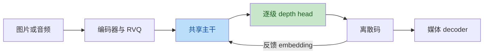

# LongCat-Next：模型、SGLang 与 Omni 对齐

核查基线和证据等级见 [索引](README.md)。本文件记录源码观察，不把优化配置的存在当作性能实测。

## 模型的三个自回归尺度

LongCat-Next 使用 DiNA（Discrete Native Autoregressive）：文本、图像、音频通过离散表示接入同一主干。主干来自 LongCat-Flash-Lite A3B，采用 MLA、Shortcut MoE 和 N-gram embedding。

实际 checkpoint 是 14 个复合 block、每 block 两个 attention，总共 28 个 attention 模块。视觉、音频分别有 4 层 depth head，每个空间/时间位置依次预测 8 级 RVQ 码。不能混淆“主干 block 数”“head 网络层数”和“码本级数”。

主干沿位置方向生成；depth head 沿码本深度生成 `c0 → c1 → … → c7`。Omni 的 `talker_mtp` 在这里承担 depth 预测，不等于普通投机解码，也不能把八级预测改成相互独立的并行输出。

## 模块映射

| 模块 | 官方旧 NMM Infer / FluentLLM | 官方 Omni-Flow | Omni PR #5299 |
| --- | --- | --- | --- |
| 主干 | SGLang-FluentLLM 原生 LongCat | SGLang + 外部模型包 | vLLM `FlashNgramModel` |
| 输入 | preprocessor、InputProcessor、input embeddings/multi IDs | 独立 vision/audio encoder role | multimodal processor、`embed_multimodal()` |
| 请求状态 | 显式 StateMachine/StateEnum | 状态机和 CFG sibling 生命周期 | `_ngram_ctx`、`_audio_gen`、`_visual_gen` |
| 深度预测 | 独立 OutputProcessor/Sample，模态 batch | head TP、DepthTransformerGraphRunner | `talker_mtp`，rank 0 采样后广播 |
| 反馈 | sampler 输出下一步 embedding | RequestCache 保存反馈 embedding | preprocess/hook 构造反馈 |
| 输出 | PostProcessor | 独立 image/audio decoder role | combined MultiDecoder |

旧官方 output processor 的 head TP 默认关闭，虽然 head 类有 TP 代码。新 Omni-Flow 配置开启 head TP，并将 head attention 配成 SDPA。Omni PR 依赖 checkpoint remote-code head，保留 rank-0 路径。

共享模型结构不等于已经数值对齐：sampling 的步数、反馈位置、码范围、N-gram 边界和请求映射都会改变结果。必须先在相同前缀下比较逐级 logits，再评价自由生成质量。

## KV cache 之外的请求状态

Omni 还维护 N-gram 左上下文、生成步数、图像网格、音频 delay/text_end、last_hidden 和已有码历史。它们必须按 request ID 隔离，并在完成、取消、抢占恢复时保持一致。

最新 PR 已使用 batch-aligned media lists，并从 runner 接收 logits-row 顺序。此前把生成字典顺序当 batch 顺序、压紧少数请求的媒体帧等问题，不能再次当作当前未修缺陷。

## CFG 与流水线

视觉 CFG 使用 `uncond + scale × (cond − uncond)`，条件/无条件流必须共享每级采样码及下一步视觉反馈。

Omni 用 `__cfg_visual` twin 表达无条件请求。同批且活跃时合并 logits；缺配对时当前代码会独立采样。`max_num_seqs >= 2` 只是容量条件，不保证两请求原子准入或同一逻辑步推进。先前独立生成写入的 KV 历史不能靠之后同步网格计数修复。

当前完整部署是 thinker → combined decoder，`async_chunk:false`。原因是 PR 所依赖的 orchestrator 转发限制，原始三个连续 stage 无法正确表达 thinker 到两个 decoder 的分支。combined decoder 是接入方案，后续应让拓扑与数据依赖由框架明确表达。

## 性能观察与采集计划

| 观察 | 应验证的证据 | 后续方案 |
| --- | --- | --- |
| 每请求、逐级调用 head | rank 0 耗时、其他 rank GPU 空洞、broadcast | 同一级跨请求 batch；再评估 TP |
| eager 小算子 | launch 次数、CPU 间隙、graph replay 覆盖 | 固定 buffer、graph bucket |
| N-gram per-request hook | CPU 时间、同步、查表 HBM 流量 | batch hash/embedding |
| code history 反复 cat | allocation/copy 随输出长度增长 | 预分配或分块 buffer |
| embedding 多份存储 | allocator 常驻与初始化峰值 | 共享只读 storage，保持 TP collective 对称 |
| decoder 与 thinker 共置 | 各进程关键路径、显存峰值、AR P95 | decoder 独立部署、批处理、背压 |

nsys 捕获实际 CUDA worker/rank，不能仅 profile HTTP client。ncu 用于独立分析已发现的热点 kernel，受采样干扰的时间不能当作吞吐结果。Ascend 使用 torch_npu.profiler/msprof 和 HCCL trace。

benchmark 固定 checkpoint/revision、框架版本、采样、输入长度、媒体尺寸、decoder steps、硬件、CPU 和共置方案。分别比较匹配配置和各框架最佳已验证配置；报告成功率、质量、TTFT/P95、有效吞吐、图像生成时长和音频 RTF。

## Ascend 与生产声明

框架支持 NPU不代表 LongCat-Next 已支持。PR decoder 仍按 CUDA/CPU 选设备，head 保留 CUDA 假设；尚无该模型最新版本 NPU E2E。LongCat-Image 的 NPU 支持也不能替代 LongCat-Next 的验证。

生产条件按“任务 × API × 硬件 × 配置”声明。缺 graph、量化或某种硬件可以是明确限制；范围内的错误反馈、串请求、取消挂死和质量回归不能通过缩小文案掩盖。

## 可追溯来源

- [模型报告 §2](https://arxiv.org/html/2603.27538v1#S2)。
- [PR thinker 固定源码](https://github.com/gangula-karthik/vllm-omni/blob/c90ebc1d07ba8c0b583586a1eddf91f531047bce/vllm_omni/model_executor/models/longcat_next/modeling_longcat_next.py)。
- [PR deploy](https://github.com/gangula-karthik/vllm-omni/blob/c90ebc1d07ba8c0b583586a1eddf91f531047bce/vllm_omni/deploy/longcat_next_4gpu_80gb_multi_decoder.yaml)。
- [官方旧 output processor](https://github.com/meituan-longcat/LongCat-Next-inference/blob/70ab100beecaaa77c1f45c0cf9ec89a4faf20fd8/modules/output_processor.py)。
- [官方 Omni-Flow LongCat 配置](https://github.com/meituan-longcat/omni-flow/blob/b11524d2fd49ef63028fe1f672879d8007bc409c/omni_flow/examples/longcat_next/config_sglang.yaml)。
