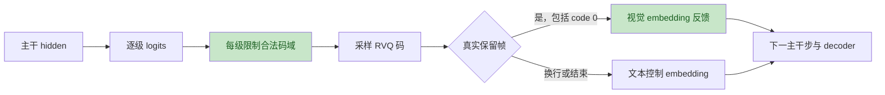
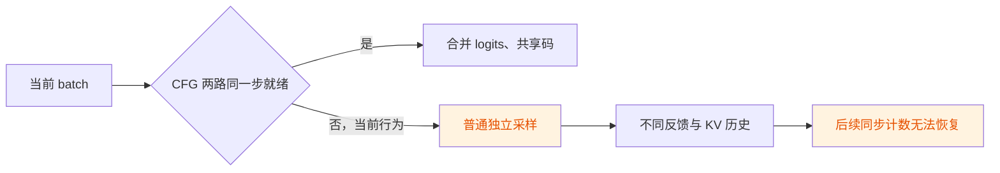

# LongCat-Next 已有提交审查

审查对象：上游 PR #5299 的 `c90ebc1d07ba`，以及本地旧基线上的四项改进。目标是确认哪些改动仍有价值、哪些已被吸收、哪些尚不足以支撑生产声明。

## 判断

这份 PR 已完成有实质价值的三模态接入，但“接口接通”走在“数值、混合并发和性能验收”前面。复杂生成状态放入多个 hook，正确性依赖调用顺序、隐式字典和调度条件；单请求生成成功不能覆盖这些契约。

不应继续用旧版本的 DCO/文档失败、图像尺寸丢失或串请求问题批评当前 head。作者已在 10 月补了这些修复。真正仍成立的问题如下。

## 确认的问题

两名独立验证者均确认下面四项机制存在；严重性评级有 P1/P2 差异，本表保守使用 P2，并列出实际影响。执行的是源码复核和隔离 CPU 逻辑验证，没有真实 GPU 并发或完整质量评测。

| ID | 优先级 | 问题与影响 | 当前基线位置 | 处理 |
| --- | --- | --- | --- | --- |
| R1 | P2 | 普通/CFG 视觉采样仅屏蔽 level 0 的额外类，其余级别可输出非量化码；累计 offset 后会污染反馈语义 | [974–975](https://github.com/gangula-karthik/vllm-omni/blob/c90ebc1d07ba8c0b583586a1eddf91f531047bce/vllm_omni/model_executor/models/longcat_next/modeling_longcat_next.py#L974-L975)、[1033](https://github.com/gangula-karthik/vllm-omni/blob/c90ebc1d07ba8c0b583586a1eddf91f531047bce/vllm_omni/model_executor/models/longcat_next/modeling_longcat_next.py#L1033) | 每级屏蔽 `visual_codebook_sizes[level]` |
| R2 | P2 | `frame_kept and deoff != 0` 将合法 level-0 code 0 当成无视觉码；码被保存，但反馈成文本 embedding | [1375](https://github.com/gangula-karthik/vllm-omni/blob/c90ebc1d07ba8c0b583586a1eddf91f531047bce/vllm_omni/model_executor/models/longcat_next/modeling_longcat_next.py#L1375)、[1436](https://github.com/gangula-karthik/vllm-omni/blob/c90ebc1d07ba8c0b583586a1eddf91f531047bce/vllm_omni/model_executor/models/longcat_next/modeling_longcat_next.py#L1436) | 保留帧直接构造视觉反馈，覆盖普通/CFG |
| R3 | P2 | replicated buffer 与 depth Embedding 再次 clone，重复持有整表；FP32 中间转换另增初始化峰值 | [762–765](https://github.com/gangula-karthik/vllm-omni/blob/c90ebc1d07ba8c0b583586a1eddf91f531047bce/vllm_omni/model_executor/models/longcat_next/modeling_longcat_next.py#L762-L765)、[782–783](https://github.com/gangula-karthik/vllm-omni/blob/c90ebc1d07ba8c0b583586a1eddf91f531047bce/vllm_omni/model_executor/models/longcat_next/modeling_longcat_next.py#L782-L783)、[800–816](https://github.com/gangula-karthik/vllm-omni/blob/c90ebc1d07ba8c0b583586a1eddf91f531047bce/vllm_omni/model_executor/models/longcat_next/modeling_longcat_next.py#L800-L816) | 共享只读 storage，直接转换目标 dtype |
| R4 | P2 | 配对只从当前 batch 的 twin 建立；root-only 批次不能识别缺配对，独立采样且不告警；已识别缺配对也降级普通采样 | [1133–1136](https://github.com/gangula-karthik/vllm-omni/blob/c90ebc1d07ba8c0b583586a1eddf91f531047bce/vllm_omni/model_executor/models/longcat_next/modeling_longcat_next.py#L1133-L1136)、[1278–1297](https://github.com/gangula-karthik/vllm-omni/blob/c90ebc1d07ba8c0b583586a1eddf91f531047bce/vllm_omni/model_executor/models/longcat_next/modeling_longcat_next.py#L1278-L1297) | 后续独立做持久 pair 身份和成对调度 |

反证与限定：

- R1 不等于“必然 VQ 数组越界”：真实 VQ 物理表有额外行，编码器最近邻搜索排除该行。问题是非法码和反馈别名，不是已证明的崩溃。
- R2 的 code 0 合法性来自真实 VQ 搜索：第 0 行参与 `embed[:-1]` 的距离计算，argmin 没有做索引平移。
- R3 的 TP replicated lookup 有合理性，可以避免 rank 0 单独调用 collective；应去掉的是第二份 clone。882 MiB/rank 限定 BF16、hidden=3072、视觉131072行、音频19456行，并要求该 rank 实际初始化两表。FP32 转换只影响初始化峰值。
- R4 在两流同批、活跃且步数对齐时公式正确。容量配置和 replica affinity 不提供原子调度保证；CFG=1 或没有展开 twin 的请求不应误判。

## 调用链

## 四个旧改进提交的去重

| 旧提交 | 原意 | 当前处理 |
| --- | --- | --- |
| A `f632e10c1` | 保留图像尺寸、补回 prompt 末尾 IMG_START | 作者已补尺寸优先级；不重复移植旧 bridge |
| B `c1b281278` | 所有视觉级别合法性、保留 code 0 | R1/R2 仍存在；移植最小修改及回归测试 |
| C `a1df93515` | logits、payload、prefill 请求身份 | 作者已吸收多项对应修复；旧接口不能盲目 cherry-pick |
| D `043959a5c` | embedding 与 depth head 共享存储 | R3 仍存在；独立移植并验证 dtype/数值/storage |

旧分支自己的问题：

1. 绑定旧 PR 基线，与新的 runner/payload 接口不同，直接叠加容易覆盖作者后续修复。
2. 隔离 harness 替换了运行时导入；通过结果不能宣称完整 CI、TP、权重加载或服务验证。
3. 新增小表测试能证明存储与契约，不证明真实生成质量或吞吐。
4. 一次提交混入正确性、runner 接口与性能改动会增加审核负担。新的代码分支按视觉正确性和存储共享分成两个提交。

## 未解决的工程缺口

在线生图/TTS、准确率套件、可持续真模型 CI、CFG 调度、depth-head batch/graph、Ascend 是独立工作项。它们需要不同证据，不能用一次“全功能大 PR”同时解决。

优先让作者吸收小修复，避免向上游重复提交整个模型适配；更大的 runtime 改造先写 RFC/issue，固定任务范围和可测验收条件。具体草稿及顺序见 `longcat-next/roadmap` 分支。
