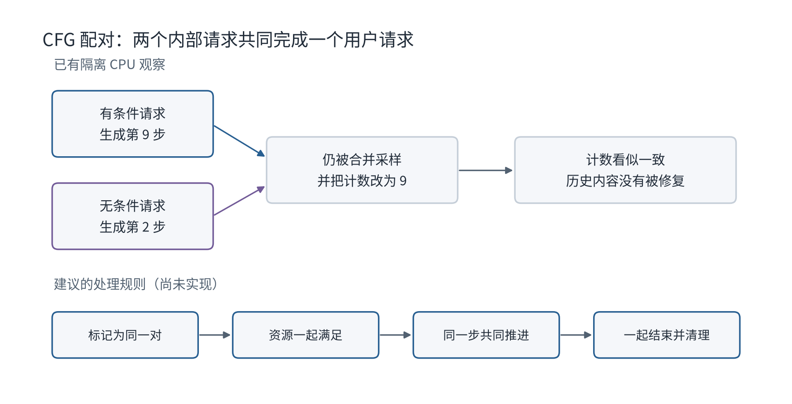
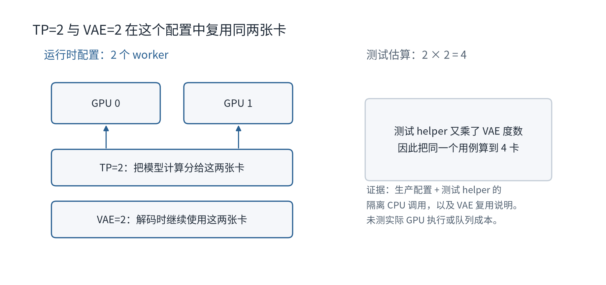

# 一步步认识 LongCat-Next 与 vLLM-Omni 项目

这不是源码索引，也不是审查报告。

它只做一件事：让已经理解 Transformer、Attention、Embedding、KV Cache 和常见并行方式的读者，逐步看懂这个 LongCat-Next 适配项目究竟在做什么、修了什么、还缺什么。

请按顺序阅读。每一步只增加一个项目内的新概念。读完一步后，先回答该步末尾的问题；答不出来就停在这里，不要先跳去看源码。

全文分为 9 个阶段。主线始终跟随一个图像生成请求，不重复讲通用机器学习基础。

本文中的测试结果和代码状态来自已经完成的历史调查，不是刚刚运行得到的新结果。

---

## 第一阶段：先看懂这个项目要接入什么

### 第 1 步：LongCat-Next 不只是一个聊天模型

LongCat-Next 的同一个主干可以处理文字、图像和音频。

对这个项目而言，最重要的不是“它是多模态模型”这句话，而是它有两类输出：

```text
普通文字 token
图像或音频的离散码
```

图像、音频最终都要由离散码还原成媒体。

只记住：**主干既会生成文字，也会生成供媒体解码器使用的码。**

停下来回答：LongCat-Next 生成图片时，主干是直接输出像素，还是先输出离散码？

---

### 第 2 步：vLLM-Omni 负责把模型放进推理运行时

模型源码只定义怎样计算。

在线推理还需要处理：

- 请求怎样进入。
- 一轮选择哪些请求执行。
- 每条请求的状态放在哪里。
- 多卡怎样参与。
- 生成的码怎样交给媒体解码器。
- 请求结束后怎样清理资源。

vLLM-Omni 提供这些运行时能力，并允许一个模型由多个 stage 组成。

只记住：**这个项目不是重新训练 LongCat-Next，而是把它接入 vLLM-Omni 的请求与执行系统。**

停下来回答：这个项目主要改变模型权重，还是改变模型怎样被运行？

---

### 第 3 步：当前完整部署只有两个 stage

完整部署使用两个 stage：

```text
Stage 0：thinker
Stage 1：multi_decoder
```

`thinker` 运行主干、文字输出和逐级媒体码生成。

`multi_decoder` 根据请求中实际出现的码，选择图像解码或音频解码。

只记住：**主干负责生成码，combined decoder 负责把码还原成媒体。**

停下来回答：图片最终在哪个 stage 被还原？

---

### 第 4 步：为什么不是 thinker、image decoder、audio decoder 三个 stage

直觉上可以设计成：

```text
thinker → image decoder
        → audio decoder
```

但调查基线中的 orchestrator 实际按相邻 stage 向后传递。

如果写成三个连续 stage，audio decoder 会接到 image decoder 的输出，而不是 thinker 的原始输出。

当前适配因此把两个 decoder 合并成 `LongcatNextMultiDecoder`，绕开这个拓扑限制。

只记住：**combined decoder 是当前运行时拓扑限制下的接入方案，不是模型数学上必须合并。**

停下来回答：两个 decoder 合并，是因为图像和音频算法相同，还是因为当前 stage 转发方式有限制？

---

### 第 5 步：项目的第一条完整链路

现在可以先记住整条主路径：

```text
用户请求
  ↓
thinker 生成文字控制 token 和媒体码
  ↓
multi_decoder 读取图像码或音频码
  ↓
图片或音频
```

这条链还没有解释“一个图像位置为什么有 8 个码”，也没有解释 CFG。

只记住：**当前完整部署是一条两阶段链。**

停下来回答：用户请求经过哪两个 stage？

---

### 第一阶段检查

你现在应该能够解释：

1. 项目不重新训练模型。
2. thinker 生成什么。
3. multi_decoder 做什么。
4. 为什么当前没有拆成三个 stage。

如果这四点还不清楚，请不要继续。

---

## 第二阶段：跟着一次图像生成请求走

### 第 6 步：普通请求先进入 thinker

请求首先由 tokenizer 和多模态 processor 处理，然后进入 thinker。

本教程不展开通用 tokenization 或 embedding。只关注一个项目特有事实：

thinker 会根据控制 token 判断当前处于普通文字生成，还是已经进入图像生成状态。

只记住：**同一个 thinker 会在文字模式和图像模式之间切换。**

停下来回答：项目是否为文字和图像分别启动两个完全独立的主干？

---

### 第 7 步：`IMG_START` 启动图像状态

当可见 token 流出现图像开始标记时，模型为该 `request_id` 创建图像生成状态。

状态记录至少包括：

```text
gen_step：当前生成到哪一步
token_w：每行有多少图像位置
token_h：共有多少行
cfg_scale：CFG 强度
terminal：是否结束
```

这些状态保存在 `_visual_gen[request_id]`。

只记住：**图像生成不是只看当前 token，还要保存按请求隔离的状态。**

停下来回答：两条图像请求能否共用同一个 `gen_step`？

---

### 第 8 步：图像尺寸决定要生成多少位置

调用方应通过 `token_h` 和 `token_w` 告诉模型图像码网格的高和宽。

当前实现按下面的长度推进：

```text
token_h × (token_w + 1)
```

多出的 `+1` 是每行末尾的换行位置。

如果尺寸缺失，当前实现会警告并回退到 `37×37`。

只记住：**图像生成长度由码网格决定，不应只靠 `max_tokens` 猜结束位置。**

停下来回答：为什么宽度为 `token_w`，每行却推进 `token_w + 1` 步？

---

### 第 9 步：像素位置与换行位置执行不同动作

每一行包含真实图像位置，行末还有一个换行位置。

真实位置保留一组图像码；换行位置只推进可见控制流，不应保存成像素码。

```text
像素 像素 像素 ... 换行
像素 像素 像素 ... 换行
```

网格完成后，模型强制产生图像结束标记。

只记住：**并不是每次调用深度预测后都保留一帧图像码。**

停下来回答：行末换行位置会不会作为一个真实图像位置交给 decoder？

---

### 第 10 步：`preprocess` 决定本轮是否调用深度预测

`preprocess` 读取本轮最后一个可见 token，更新图像状态。

只有在真正的单 token decode 轮次，它才产生 `mtp_inputs`，让 runner 调用 `talker_mtp`。

如果图像开始标记只是一个多 token prefill chunk 的末尾，本轮还不能提前增加图像步数。

否则会出现：

```text
状态计数增加了
但 talker_mtp 实际没有运行
```

只记住：**状态步数必须与真实 `talker_mtp` 调用一一对应。**

停下来回答：为什么看到图像开始标记后，不能无条件立刻增加生成步数？

---

### 第 11 步：`talker_mtp` 为本轮图像位置生成 8 个码

进入图像 decode 后，`talker_mtp` 读取 thinker 保存的 hidden state。

它调用视觉 depth head，生成当前图像位置的 8 级 RVQ 码。

输出形状可以先理解为：

```text
一个请求的一次图像位置 → [c0, c1, ..., c7]
```

只记住：**主干的一次图像位置，内部还包含 8 级码生成。**

停下来回答：一个图像位置只对应一个离散码吗？

---

### 第 12 步：码一边保存，一边构造下一步输入

如果本轮是真实图像位置，8 个码会做两件事：

1. 保存到输出，后续交给图像 decoder。
2. 经过图像相关层，构造 thinker 下一步的输入。

如果本轮是换行或结束位置，就不保留图像码，而是使用对应的控制 token 路径。

只记住：**同一组图像码同时影响最终图片和后续自回归历史。**

停下来回答：为什么“最终保存的码正确”仍不足以保证下一步生成正确？

---

### 第 13 步：multi_decoder 按请求实际输出选择解码路径

thinker 的输出载荷中可能包含：

```text
visual_token_ids
audio_token_ids
```

`LongcatNextMultiDecoder` 检查哪一种码存在，再调用对应 decoder。

因此 pipeline 配置中的静态 `final_output_type` 不能完整描述每个请求的真实媒体类型；真实类型由请求触发的生成路径决定。

只记住：**combined decoder 不是同时解两种媒体，而是按请求选择路径。**

停下来回答：一个图像请求会不会因为 stage 的静态字段写着 audio，就真的进入音频 decoder？

---

### 第二阶段检查

现在你应该能复述这条路径：

```text
IMG_START
→ 建立 request 专属图像状态
→ 按网格推进
→ 每个真实位置调用 talker_mtp
→ 生成 8 个码
→ 保存码并构造下一步输入
→ multi_decoder 还原图片
```

如果你不能解释换行位置为什么不保留码，请回看第 8 到 12 步。

---

## 第三阶段：理解一个位置内部的 8 级码

### 第 14 步：8 级码不是 8 个互相独立的分类

视觉 depth head 按下面的依赖关系生成：

```text
c0
c1 | c0
c2 | c0,c1
...
c7 | c0,...,c6
```

后一层读取前面已经采样的码。

只记住：**8 级可以逐级执行，不能完全并行独立采样。**

停下来回答：为什么不能同时独立预测 `c0` 到 `c7`？

---

### 第 15 步：可以并行的是不同请求的同一级

假设同时有四条图像请求。

它们都在生成 `c3` 时，可以将四条请求的 `c3` 计算组成一个 batch。

但单条请求内部仍要等待 `c2` 结果，才能计算 `c3`。

```text
可以：请求 A/B/C/D 的 c3 一起算
不可以：请求 A 的 c0...c7 完全独立一起算
```

只记住：**跨请求同级 batching 与单请求跨级并行是两回事。**

停下来回答：要优化 depth head 吞吐，优先寻找哪一种并行机会？

---

### 第 16 步：每一级都有自己的合法码范围

第 `i` 级的输出必须满足：

```text
0 ≤ ci < codebook_size[i]
```

depth head 的 logits 还可能包含一个额外特殊类。

这个特殊类用于控制语义，不属于应保存的普通量化码。

只记住：**每一级都要按自己的 codebook 大小限制采样。**

停下来回答：只检查 `c0` 的合法范围，能否保证整组 8 个码合法？

---

### 第 17 步：额外特殊类不能进入普通图像码

调查基线只在第 0 级屏蔽额外类。

后续级别仍可能采到各自的额外类。

这不等于必然数组越界，因为真实物理表存在额外行；已经确认的问题是：

```text
输出不再属于有效量化码域
反馈语义可能与预期不一致
```

只记住：**问题是非法码和反馈别名，不是已证明的必然崩溃。**

停下来回答：为什么文档不能把这个问题简单写成“必然越界”？

---

### 第 18 步：当前修复在所有视觉级别屏蔽额外类

视觉修复提交 `b56c2a94b` 将每一级的额外类从采样候选中排除。

普通视觉采样和 CFG 视觉采样都使用相同规则。

修复目标不是改变采样算法，而是让采样结果始终落在真实码本范围内。

只记住：**第一项正确性修复是“每一级都限制合法码域”。**

停下来回答：这项修复会不会消除 RVQ 的逐级依赖？

---

### 第 19 步：码值 0 是合法图像码

第 0 级采样结果可以等于 0。

旧逻辑曾使用：

```text
frame_kept and deoff != 0
```

来判断是否构造视觉反馈。

结果是：码已经被保存为真实图像位置，但下一步没有收到对应视觉反馈。

只记住：**码值 0 不表示“这一帧不存在”。**

停下来回答：判断一个位置是否保留，应该看 `frame_kept`，还是看码值是否非零？

---

### 第 20 步：第二项正确性修复按位置状态选择反馈

修复后的视觉路径只要 `frame_kept=True`，就使用视觉码构造下一步输入。

换行或结束位置则继续使用文字控制路径。

它不再把合法码 0 当作“无图像”。

只记住：**是否反馈视觉信息由位置类型决定，不由码值是否为零决定。**

停下来回答：这项修复主要改变最终 decoder，还是改变 thinker 的下一步历史？

---

### 第三阶段检查

你现在应该能解释两个视觉修复：

1. 每一级都屏蔽额外特殊类。
2. 合法 code 0 的保留位置仍使用视觉反馈。

并且知道它们没有改变 8 级码之间的因果顺序。


图中的箭头表示依赖，不表示各级实测耗时。

---

## 第四阶段：理解码表存储优化

### 第 21 步：depth head 需要读取图像和音频码表

主干已有可读取的媒体码表。

depth head 在构造下一步输入时，也要查询相同码对应的向量。

调查基线把已有表再次 clone 成独立 `Embedding`。

只记住：**两处读取的是相同只读数据。**

停下来回答：如果两个消费者都不修改数据，是否必须各保存一份物理副本？

---

### 第 22 步：不能简单删除所有 replicated table

当前 depth head 主要在 rank 0 执行。

主干的 TP embedding 查询可能要求整个 TP group 共同参与。

如果 rank 0 独自在 depth head 内调用这条 collective 路径，其他 rank 没有参加，可能造成死锁。

因此，项目保留每个参与 rank 可独立读取的 replicated rows。

只记住：**需要删除的是第二次 clone，不是所有 replicated 存储。**

停下来回答：为什么不能让 rank 0 临时直接调用任意 TP embedding 路径？

---

### 第 23 步：存储修复让两个模块共享底层数据

提交 `53785219b` 使用已有 replicated rows 构造冻结的 embedding view。

两个模块拥有不同 Python 对象，但底层 storage 相同。

权重保持只读，重复访问也不会重新创建副本。

只记住：**优化目标是共享 storage，同时保持原来的读取接口。**

停下来回答：对象不同但 storage 相同，是否仍能减少一份物理数据？

---

### 第 24 步：882 MiB 是条件化计算

在下面条件下：

```text
BF16：每个数 2 字节
hidden size：3072
视觉表：131072 行
音频表：19456 行
两张表都在该 rank 初始化
```

少一份重复表为：

```text
(131072 + 19456) × 3072 × 2
= 924844032 字节
= 882 MiB
```

只记住：**882 MiB/rank 是局部存储计算，不是完整模型真机显存结果。**

停下来回答：如果某个 rank 没有初始化音频表，还能直接套用 882 MiB 吗？

---

### 第 25 步：去掉 FP32 中间转换是另一件事

旧初始化还可能先转成 FP32，再转到目标 dtype。

移除这一步可以降低初始化期间的临时峰值。

它与“删除常驻第二份表”不同：

```text
共享 storage：减少常驻重复数据
去掉 FP32 中转：减少初始化临时数据
```

只记住：**常驻存储与初始化峰值要分别描述。**

停下来回答：去掉 FP32 中转能否直接写成持续减少 882 MiB？

---

### 第 26 步：当前证据没有证明吞吐提升

存储回归检查：

- FP32/BF16 查值一致。
- 权重冻结。
- 底层 storage 共享。
- 重复访问幂等。

它没有运行完整 LongCat 权重，也没有测端到端请求吞吐。

只记住：**存储行为正确，不等于服务已经更快。**

停下来回答：这项提交当前最强的性能相关结论是什么？

---

### 第四阶段检查

请区分三件事：

1. replicated rows 为什么仍保留。
2. 第二次 clone 为什么可以删除。
3. 882 MiB 为什么有适用条件。

答不出来时，只回看第 21 到 26 步。

---

## 第五阶段：理解 CFG 为什么拆成两个内部请求

### 第 27 步：CFG 需要两路预测

图像 CFG 组合：

```text
u + s × (c - u)
```

其中：

```text
c：有条件预测
u：无条件预测
s：引导强度
```

LongCat 的实现需要两路拥有各自的主干历史。

只记住：**CFG 不是复制一份 logits，而是运行两条不同条件的历史。**

停下来回答：有条件与无条件两路的 hidden state 应该完全相同吗？

---

### 第 28 步：一个用户请求会展开成两个内部请求

`expand_longcat_cfg_prompts` 为图像请求创建：

```text
parent request
parent request + "__cfg_visual"
```

后者是无条件 companion，也称 twin。

客户端仍只关心一个用户请求。

只记住：**CFG pair 是一个用户请求对应两个内部调度实体。**

停下来回答：companion 是第二个独立用户请求吗？

---

### 第 29 步：两路必须对齐生成进度，而不是 KV 数值

两路提示条件不同，因此它们的 KV 内容本来就不同。

需要保证的是：

```text
都在生成同一个图像位置
都在处理同一个 RVQ level
共享组合后采样得到的码
```

只记住：**CFG 对齐的是逻辑生成位置，不是两份缓存内容相等。**

停下来回答：为什么“两个请求的 KV 数值不同”本身不表示出错？

---

### 第 30 步：同一步时，模型合并两路 logits

当 parent 和 twin 都在当前 batch，且两路图像状态都活跃时：

1. 分别计算两路 depth logits。
2. 按 CFG 公式组合。
3. 从组合 logits 采样一组码。
4. 将同一组码写到 parent 和 twin。
5. 两路构造同一组视觉反馈。

只记住：**两路历史不同，但本轮采样码和反馈必须共享。**

停下来回答：CFG 组合后应该为两路分别再采样一次吗？

---

### 第 31 步：`max_num_seqs=2` 只提供容量

部署配置设置：

```text
max_num_seqs: 2
```

它表示 thinker 最多可以同时容纳两条序列。

它不保证：

- parent 与 twin 同时被接纳。
- 每轮一起被选中。
- 一方结束时另一方一起清理。

只记住：**容量为 2，不等于具备“成对调度”语义。**

停下来回答：为什么把 `max_num_seqs` 从 1 改成 2 仍不足以解决 CFG 生命周期？

---

### 第 32 步：当前配对主要从“本轮 batch 里出现了谁”推断

模型先扫描当前 `req_ids`。

看到后缀为 `__cfg_visual` 的请求后，才建立 parent 到 twin 的映射。

如果本轮只有 parent，模型甚至无法仅从 parent 的普通 ID 判断它本应有一个 twin。

只记住：**当前模型层看到的是本轮行，不是持久化的完整 pair 身份。**

停下来回答：root-only batch 为什么可能无法判断 companion 缺席？

---

### 第 33 步：缺一方时当前逻辑会退化成独立采样

如果模型识别到 pair，但两路没有同时活跃，当前代码记录 warning，然后为当前行独立采样。

如果本轮只有普通 parent ID，连 warning 都可能没有。

独立采样会让两路得到不同的码与后续历史。

只记住：**silent 或 warning fallback 都会改变 CFG 的生成语义。**

停下来回答：为什么“先独立走一步，下轮再同步”不可靠？

---

### 第五阶段检查

现在你应该知道：

```text
一个用户请求
→ parent + twin
→ 两份条件历史
→ 同一步组合 logits
→ 一组共享码
→ 两路共享反馈
```

如果你仍把 `max_num_seqs=2` 当作调度保证，请回看第 31 到 33 步。

---

## 第六阶段：看懂两个 CFG 复现

### 第 34 步：第一个复现只让 parent 执行

测试先准备：

```text
parent：step=4，活跃
twin：step=4，活跃
```

但本轮传给 `talker_mtp` 的 batch 只有 parent。

固定 depth head 让每一级都输出合法码 7。

只记住：**测试故意构造“pair 存在，但本轮只调度一方”。**

停下来回答：这个复现是在测试图像质量，还是测试局部配对分支？

---

### 第 35 步：parent 单独增加一帧

实际观察：

```text
输出：[7,7,7,7,7,7,7,7]
parent 历史：增加一帧
twin 历史：没有增加
```

这证明生产模型方法在该输入下允许一方独立推进。

它没有证明真实 scheduler 多常产生这个 batch。

只记住：**局部错误行为已复现，线上触发概率尚未测量。**

停下来回答：这个测试能否直接得出“真实服务每次都会错”？

---

### 第 36 步：第二个复现让两路处于不同步骤

测试准备：

```text
parent：step=9
twin：step=2
```

两路同时出现在当前 batch。

理想行为应是拒绝组合或在更早阶段阻止这种状态出现。

只记住：**同时出现不等于处于同一逻辑位置。**

停下来回答：只检查“两路都在 batch”为什么不够？

---

### 第 37 步：当前逻辑仍组合，并覆盖 twin 计数

实际观察：

```text
两行得到共享码
twin 的 step 被同步成 9
```

计数看起来一致，但 step 2 到 step 8 的生成与反馈没有凭空补回来。

只记住：**同步一个计数器不能修复已经错位的生成历史。**

停下来回答：为什么把 twin 的数字从 2 改成 9 不能恢复正确状态？

---

### 第 38 步：这两个复现的证明范围很窄

测试直接调用生产 `talker_mtp`，复用现有 fixture。

它替代了：

- 完整 vLLM runtime。
- 真实 depth head 权重。
- TP 通信。
- GPU 调度。

因此结论是：

```text
模型方法的这些局部分支存在该行为
```

而不是：

```text
真实 4 卡服务已经复现相同故障频率和质量损失
```

只记住：**局部复现与运行时复现是两层证据。**

停下来回答：下一层验证最需要加入哪个组件？

---

### 第 39 步：正确修复应覆盖完整 pair 生命周期

建议的生命周期是：

```text
建立 pair 身份
→ 两路一起满足准入条件
→ 同一步共同推进
→ 任一路结束时形成一致终态
→ 清理两路资源
```



图上半部是隔离 CPU 观察；下半部是尚未实现的设计。

只记住：**问题不只在采样函数，而在请求从创建到销毁的整条路径。**

停下来回答：为什么只在 `talker_mtp` 增加一个 step 相等断言还不算完整解决？

---

### 第 40 步：仓库已有通用 CFG scheduler，但不能直接接上

`OmniCFGARScheduler` 已被 Breeze-TTS 使用。

它提供部分成对准入、进度比较和取消扩展能力。

但当前限制包括同步调度、完整 prefill、关闭 prefix cache、无 speculative decoding/KV connector，以及特定 KV group 条件。

只记住：**已有调度器是可复用起点，不是即插即用答案。**

停下来回答：为什么最好复用通用能力，而不是继续在 LongCat 模型层增加后缀判断？

---

### 第 41 步：LongCat 的上下文配置会直接触发预算冲突

LongCat 当前配置：

```text
max_model_len = 65536
max_num_batched_tokens = 8192
```

已有 CFG scheduler 要求 batched token 预算至少达到两倍最大上下文：

```text
2 × 65536 = 131072
```

直接设置 scheduler 类会在启动阶段失败。

只记住：**接入调度器前必须重新设计实际请求预算，不能只改配置字段。**

停下来回答：把 `max_model_len` 静默改小，是否等于解决了 CFG 调度问题？

---

### 第 42 步：结束路径也必须成对处理

请求可能通过不同路径结束：

```text
主动取消
正常 EOS
长度上限
超时
运行错误
```

显式取消可能经过 `finish_requests`，正常输出结束还会经过 `update_from_output → _free_request`。

只改其中一个函数，会遗漏其他终止方式。

只记住：**pair 的结束语义必须覆盖所有资源释放入口。**

停下来回答：为什么取消测试通过仍不能证明正常 EOS 后没有残留？

---

### 第六阶段检查

你现在应该能区分：

1. 模型层 CFG 公式。
2. 调度层 pair 生命周期。
3. 隔离模型方法复现。
4. 真实 runtime/GPU 复现。

这四者不能互相替代。

---

## 第七阶段：理解四张卡怎样放置

### 第 43 步：thinker 使用 TP=4

当前部署把 thinker 放到：

```text
GPU 0,1,2,3
```

`tensor_parallel_size=4` 表示 thinker 的模型计算由四个 rank 共同执行。

只记住：**thinker 横跨四张卡。**

停下来回答：GPU 3 是否只服务 decoder？

---

### 第 44 步：multi_decoder 与 thinker rank 3 共用 GPU 3

multi_decoder 的 `devices` 是：

```text
"3"
```

因此 GPU 3 同时承载：

```text
thinker 的第 4 个 TP rank
combined image/audio decoder
```

部署注释估算 GPU 3 总占用约 57–61 GiB，目标是适配 80 GiB 卡。

这是配置注释中的预算，不是本次 fork 新测的显存结果。

只记住：**stage 数量与物理卡数量不是一一对应。**

停下来回答：两个 stage 是否一定需要五张卡？

---

### 第 45 步：四卡布局解决“放在哪里”，不解决“何时执行”

设备布局回答：

```text
哪个 stage 使用哪些 GPU
```

CFG 调度回答：

```text
parent 与 twin 哪一轮一起执行
```

前者正确，不会自动推出后者正确。

只记住：**placement 与 scheduling 是两个独立契约。**

停下来回答：两路请求落在同一个服务副本，是否就保证每轮同步？

---

### 第 46 步：卡数不能把所有并行参数机械相乘

在 vLLM-Omni 的另一项组合调查中，FLUX.2 测试配置同时设置：

```text
TP=2
VAE patch=2
```

VAE 复用已有的两个 DiT worker。

生产配置得到 2 个 worker，测试 helper 却计算为 `2×2=4`。



只记住：**有的并行轴新增 rank，有的功能复用已有 rank。**

停下来回答：为什么不能对所有“parallel size”字段直接做乘法？

---

### 第 47 步：但也不能全部改成取最大值

同一份隔离配置检查还显示：

```text
TP=2 + diffusion CFG=2 → world size 4
```

这两个轴确实需要形成乘积。

因此正确做法不是“全部相乘”，也不是“全部取最大值”，而是由生产配置明确每个轴的 rank 关系。

只记住：**资源推导需要知道每个并行轴的语义。**

停下来回答：资源计算的核心是参数名字，还是参数背后的进程组关系？

---

### 第 48 步：world size 仍不能回答显存是否足够

world size 表示需要多少工作进程或 rank。

它不能单独回答：

- 多个 stage 是否共用一张卡。
- 每个 stage 的权重和缓存占多少显存。
- decoder 是否与 thinker 同时常驻。
- 输入尺寸会产生多少临时激活。

只记住：**进程数量、设备放置和显存预算是三层问题。**

停下来回答：生产配置算出 world size=4，是否已经证明四张目标卡都不会 OOM？

---

### 第七阶段检查

请闭眼复述：

```text
thinker：TP4，使用 GPU 0-3
multi_decoder：使用 GPU 3
```

并解释：

1. 为什么两个 stage 可以放在四张卡。
2. 为什么卡放对了仍不保证 CFG 同步。
3. 为什么 TP2+VAE2 不一定需要四张卡。

---

## 第八阶段：准确理解测试结果

### 第 49 步：本项目新增了 16 项局部回归

两项提交新增：

```text
12 项视觉码与反馈测试
4 项存储共享测试
```

它们分别对应两类修改。

只记住：**新增测试数是 16，不是 72。**

停下来回答：72 中有多少是原来已有的 talker 测试？

---

### 第 50 步：原代码运行新测试时是 10 失败、6 通过

新测试不全是故障复现。

其中一些检查正常边界，本来就会通过；另一些击中了旧问题。

因此基线结果是：

```text
10 failed
6 passed
```

只记住：**基线失败建立了部分问题复现，不要求全部新测试都失败。**

停下来回答：为什么 6 项基线通过不表示测试设计失败？

---

### 第 51 步：修复后总计 72 项隔离 CPU 测试通过

视觉修复后：

```text
12 项新视觉测试 + 56 项已有 talker 测试 = 68
```

再加入 4 项存储测试：

```text
68 + 4 = 72
```

只记住：**72 是“16 新 + 56 旧”的总数。**

停下来回答：能否把 72 写成 72 次真实 LongCat 图片生成？

---

### 第 52 步：隔离 CPU harness 保留了被测方法

测试直接调用生产模型方法。

采样、视觉反馈和 storage 方法没有被替换。

但无关的 vLLM 导入、真实 depth head、TP 与 GPU 被 stub。

只记住：**它适合证明窄逻辑，不适合证明完整部署。**

停下来回答：隔离测试通过后，还缺哪一层最关键的执行证据？

---

### 第 53 步：静态检查与完整 pre-commit 不是同一件事

变更文件通过了适用的：

```text
Ruff lint / format
test marks
SPDX
forbidden imports
torch.cuda gate
git diff --check
```

本机没有执行完整 `pre-commit`。

只记住：**运行若干等价检查不能写成完整 hook 全部通过。**

停下来回答：为什么“Ruff 通过”不能替代所有仓库检查？

---

### 第 54 步：作者旧 GPU 结果不能替代当前 fork

PR 作者曾报告旧提交 `986ade20` 在 4×A100-80GB 上通过部分 E2E。

当前研究基线是 `c90ebc1d07ba`，个人修复又是后续提交。

不同代码版本的结果不能直接互相代替。

另外，426.49 秒是三项离线测试总耗时，不是单请求延迟。

只记住：**版本、硬件和工作负载必须与结论对应。**

停下来回答：为什么不能把作者旧版本的 A100 结果写成当前 fork 已通过 GPU 验证？

---

### 第 55 步：当前没有完成哪些关键验证

尚未完成：

- 匹配版本的完整 vLLM runtime。
- 真实 LongCat 权重。
- GPU 与 TP collective。
- CFG 真实调度与取消。
- 同权重官方参考的逐级质量对照。
- 端到端吞吐、P95/P99 和真机显存。
- LongCat-Next 的 Ascend E2E。

只记住：**当前成果是局部修复、局部复现和系统设计，不是生产验收。**

停下来回答：现在可以声称“LongCat-Next 在 vLLM-Omni 上生产可用”吗？

---

### 第 56 步：项目当前处于什么工程层级

当前已经超过只写接口的小玩具：

- 有真实上游模型适配基线。
- 有具体错误机制。
- 有基线失败、候选通过的局部回归。
- 有存储计算与边界。
- 有 CFG 生命周期设计。

但还没有达到完整主流生产贡献：

- 模型前置尚需重新核对上游状态。
- CFG runtime 没有实现闭环。
- 真实模型质量、并发和性能没有完成。
- 上游尚未接受这些个人提交。

只记住：**它是有证据的系统改进原型，不是 SOTA 或完整生产实现。**

停下来回答：要把它提升一个层级，最先应补“更多文档”，还是“真实 runtime 闭环”？

---

### 第八阶段检查

你应该能够准确说出：

```text
16 项新增测试
10 fail / 6 pass 的原代码对照
72 项修复后隔离 CPU 总通过
882 MiB/rank 的条件化存储计算
两个 CFG 局部复现
零项当前 fork 真模型 GPU 性能结论
```

如果其中任何数字的含义混淆，请不要继续看源码。

---

## 第九阶段：把概念映射到项目文件

到这里才开始看代码。不要一次打开所有文件。

### 第 57 步：先读 pipeline，确认两个 stage

打开：

```text
vllm_omni/model_executor/models/longcat_next/pipeline.py
```

只寻找：

1. thinker stage。
2. multi_decoder stage。
3. `input_sources=(0,)`。
4. 为什么注释说三阶段链不适用。

本步不要研究模型计算。

新认知点：**拓扑在哪里定义。**

---

### 第 58 步：再读部署文件，确认四卡 placement

打开：

```text
vllm_omni/deploy/longcat_next_4gpu_80gb_multi_decoder.yaml
```

只寻找：

1. thinker 的 TP=4 和 devices `0,1,2,3`。
2. `max_num_seqs=2`。
3. multi_decoder 的 devices `3`。
4. `max_model_len=65536` 与 batched token budget `8192`。

本步不要把配置注释当成真机实测。

新认知点：**stage 怎样映射到设备。**

---

### 第 59 步：沿 `preprocess` 读图像状态推进

打开：

```text
vllm_omni/model_executor/models/longcat_next/modeling_longcat_next.py
```

第一次只读：

```text
_advance_visual_gen
preprocess
on_requests_finished
```

寻找：

1. `IMG_START` 怎样创建状态。
2. `token_h/token_w` 怎样决定网格。
3. `decode_eligible` 怎样约束步数。
4. 请求结束时清理哪些字典。

新认知点：**可见 token 怎样驱动媒体状态机。**

---

### 第 60 步：再读 `talker_mtp` 的视觉分支

仍在同一个文件中，第一次只寻找：

```text
row_of
cfg_parent_of_twin
both_visual_active
_sample_cfg_visual_codes
frame_kept
```

沿下面顺序读：

```text
当前行属于哪个请求
→ 是否有 CFG pair
→ 普通采样还是 CFG 采样
→ 是否保留码
→ 怎样构造下一步输入
```

新认知点：**本轮 batch 行怎样映射到请求状态。**

---

### 第 61 步：再读两项修复对应测试

打开：

```text
tests/model_executor/models/test_longcat_next_visual_codes.py
tests/model_executor/models/test_longcat_next_embedding_storage.py
```

视觉测试只寻找：

1. 每级 sentinel。
2. code 0。
3. 普通与 CFG。
4. 像素与换行。

存储测试只寻找：

1. 查值相等。
2. storage 指针。
3. 冻结。
4. 重复调用。

新认知点：**测试怎样直接对应修改契约。**

---

### 第 62 步：最后读 CFG 设计，而不是先改代码

先读：

```text
planning/longcat-next/drafts/cfg-lifecycle-friendly.md
```

理解主线后，再读：

```text
planning/longcat-next/drafts/cfg-lifecycle.md
```

技术稿包含：

- pair metadata。
- 准入与 KV 页预算。
- 所有终止入口。
- CPU runtime、GPU 和真模型验收。

新认知点：**更大的修复先明确职责和验收，再进入实现。**

---

## 最终项目地图

现在你应该能看懂这张图：

```text
用户图像生成请求
        ↓
prompt_expand：普通请求 → parent + CFG twin
        ↓
┌──────────────────────────────────────┐
│ Stage 0：thinker，TP=4，GPU 0-3       │
│                                      │
│ 可见 token 推进图像状态               │
│        ↓                             │
│ 每个真实图像位置调用 talker_mtp       │
│        ↓                             │
│ depth head 依次生成 c0...c7          │
│        ↓                             │
│ parent/twin 同步时组合 CFG logits     │
│        ↓                             │
│ 保存码 + 构造下一步输入               │
└──────────────────────────────────────┘
        ↓ visual_token_ids
┌──────────────────────────────────────┐
│ Stage 1：multi_decoder，GPU 3         │
│ 图像码 → 图像；音频码 → 音频          │
└──────────────────────────────────────┘
        ↓
最终媒体
```

个人 fork 已经完成：

1. 所有视觉 RVQ 级别排除额外特殊类。
2. 合法 code 0 的保留位置使用视觉反馈。
3. depth head 与 replicated rows 共享只读 storage。
4. 16 项新增回归；修复后连同已有测试共 72 项隔离 CPU 测试通过。
5. 两个 CFG 不同步局部复现。
6. CFG 生命周期与卡/模型/输入组合改进设计。

个人 fork 尚未完成：

1. CFG pair 的真实调度生命周期实现。
2. 匹配版本的完整 runtime 和 GPU/TP 验证。
3. 同权重官方参考的逐级与媒体质量对照。
4. 当前 fork 的端到端性能和显存实测。
5. LongCat-Next Ascend E2E。
6. 上游接受或合并。

---

## 你现在应该怎样继续

先闭卷回答下面 12 个问题：

1. 当前完整部署为什么是两个 stage？
2. `IMG_START` 后模型保存哪些图像状态？
3. 一个图像位置为什么要生成 8 级码？
4. 哪一种 depth head 并行不破坏级间依赖？
5. 为什么每一级都要屏蔽额外类？
6. 为什么合法 code 0 仍要使用视觉反馈？
7. 共享 storage 删除了哪一份数据，保留了哪一份？
8. 一个用户 CFG 请求为什么变成两个内部请求？
9. 为什么 `max_num_seqs=2` 不等于成对调度？
10. 两个 CFG 复现分别观察到了什么？
11. thinker 和 multi_decoder 分别使用哪些 GPU？
12. 72 项测试为什么不能证明生产可用？

能不看文档回答 10 个以上，再按顺序打开：

1. `pipeline.py`
2. 部署 YAML
3. `_advance_visual_gen` 与 `preprocess`
4. `talker_mtp` 的视觉分支
5. 两份新增测试
6. CFG 生命周期技术草稿

不要先做性能优化。先确认真实 runtime 中 pair 身份、共同准入、同步推进和终止清理已经闭环。

## 原始证据入口

理解主线以后，再按需打开：

- [模型与框架技术分析](analysis.md)
- [已有提交审查](review.md)
- [测试计数与复验命令](VALIDATION.md)
- [分支与交接](HANDOFF.md)
- [CFG 生命周期技术草稿](https://github.com/Cheongroach/vllm-omni/blob/longcat-next/draft-cfg-lifecycle/planning/longcat-next/drafts/cfg-lifecycle.md)
- [卡、模型、输入组合技术周报](https://github.com/Cheongroach/vllm-omni/blob/longcat-next/draft-cfg-lifecycle/planning/longcat-next/drafts/weekly-2026-10-25-combinations.md)

这些材料用于查证源码、版本、测试和边界。第一次阅读本文时，不需要逐个打开。
